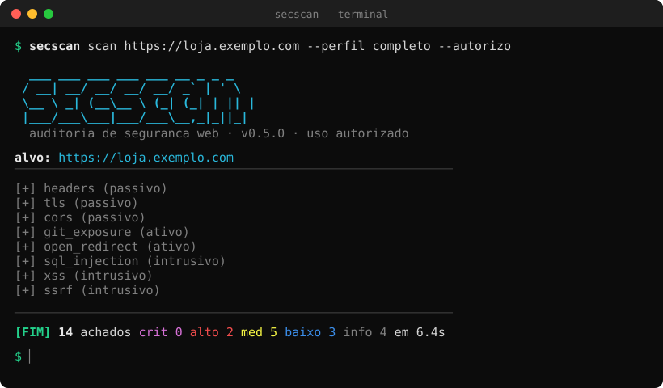

# secscan

[](https://github.com/Franciscovj/secscan/actions/workflows/ci.yml)


Ferramenta de auditoria de segurança web em linha de comando — transforma uma
gravação de alvo em um relatório estruturado de achados (severidade, confiança,
evidência, remediação e CWE/OWASP por item).



> ⚠️ **Uso autorizado apenas.** Rode o secscan **somente** em sistemas que você
> possui ou para os quais tem permissão **escrita**. Os checks intrusivos
> (injeção, força bruta) só rodam em alvos locais/privados ou com `--autorizo`.
> Escanear sistema de terceiro sem autorização é ilegal na maioria dos países.

## Por que existe

A saída foi pensada para ser consumida por **outra ferramenta ou por uma IA**:
o `--format json` é estável e descreve cada achado de forma objetiva. Também há
um **auto-teste embutido** (`secscan selftest`) que sobe um alvo de mentira local
e valida os checks sozinho — assim a ferramenta se verifica sem bater em site
real e sem gasto manual.

## Instalação

Não precisa de PyPI — instala direto do repositório. Funciona igual no **Windows, Linux e macOS**.

### Recomendado: pipx (deixa o `secscan` no PATH)

O [pipx](https://pipx.pypa.io) instala a ferramenta isolada (sem sujar o seu Python)
e cria o atalho numa pasta que já fica no PATH (`~/.local/bin` nos três sistemas):

```bash
pipx install git+https://github.com/Franciscovj/secscan.git
pipx ensurepath          # garante ~/.local/bin no PATH — abra um terminal novo depois
```

Não tem pipx? Instale uma vez: `python -m pip install --user pipx`
(no Windows, se `python` não existir, use `py -m pip install --user pipx`).

Depois disso, `secscan` roda de qualquer terminal. (Requer `git` instalado.)

### Alternativa: pip

```bash
pip install git+https://github.com/Franciscovj/secscan.git
```

Instala o comando `secscan`, mas ele só fica no PATH se o diretório de scripts do seu
Python já estiver no PATH (o pip avisa quando não está). Por isso o pipx é mais simples.

### Desenvolvimento (editável)

Para mexer no código e ver o efeito na hora. Com pipx, fica editável **e** no PATH:

```bash
git clone https://github.com/Franciscovj/secscan.git
pipx install -e ./secscan          # editável + no PATH (recomendado p/ dev)
```

Ou com venv, à moda antiga:

```bash
cd secscan
python -m venv venv
# Windows:  .\venv\Scripts\activate
# Linux/macOS:  source venv/bin/activate
pip install -e ".[dev]"
```

Sem instalar nada, também dá para rodar com `python -m secscan`.

> Onde os relatórios caem: rodando do código-fonte (clone/editável), em `<projeto>/relatorios`;
> instalado normal (pipx/pip), em `~/secscan-relatorios`. Vale para os três sistemas — os caminhos
> são resolvidos de forma portável, sem nada fixo de Windows.

## Uso

Rodar `secscan` **sem argumento** abre um menu interativo colorido. Para uso
direto / automação, os subcomandos:

```bash
# auditoria padrão (passivo + ativo), saída JSON no stdout
secscan scan https://meusite.com

# relatório HTML numa pasta
secscan scan https://meusite.com --format html -o relatorios/

# só alguns checks
secscan scan meusite.com --only headers,tls,cookies,cors

# auditoria completa, incluindo checks intrusivos (exige autorização)
secscan scan https://meusite.com --perfil completo --autorizo

# listar os checks disponíveis
secscan checks

# auto-teste (não precisa de alvo externo)
secscan selftest
```

### Principais opções do `scan`

| Opção | O que faz |
|---|---|
| `--only a,b` / `--skip a,b` | roda só / pula esses checks |
| `--perfil rapido\|padrao\|completo` | passivo / +ativo / +intrusivo |
| `--format txt\|json\|html\|md\|sarif\|all` | formato do relatório (JSON é o padrão) |
| `-o, --output DIR` | salva em arquivo(s) nessa pasta (senão, imprime no stdout) |
| `--autorizo` | confirma que você tem permissão (libera os intrusivos) |
| `--users FILE` / `--passwords FILE` | wordlists do `login_bruteforce` (ex.: SecLists) |
| `--max-tentativas N` | teto de tentativas do `login_bruteforce` (só com `--autorizo`) |
| `--rate N` | limite de requisições por segundo (padrão 10; 0 = sem limite) |
| `--threads N` / `--timeout S` | paralelismo / timeout por requisição |
| `--proxy URL` | passa por um proxy (ex.: Burp em `http://127.0.0.1:8080`) |
| `--sem-tls` | não verificar certificado |
| `--falhar-se-achar` | sai com código 1 se houver achado alto/crítico (útil em CI) |

## Checks

Organizados por quão invasivos são:

- **passivo** (só observa): `headers`, `cookies`, `cors`, `tls`, `csp_audit`,
  `info_disclosure`
- **ativo** (sonda caminhos/params): `sensitive_paths`, `git_exposure`,
  `directory_listing`, `open_redirect`, `backup_files`, `admin_panel`,
  `debug_mode`, `csrf`, `port_scan`, `subdomain_enum`, `http_methods`,
  `db_exposure`
- **intrusivo** (envia payloads — exige autorização): `sql_injection`, `xss`,
  `traversal`, `login_bruteforce`, `ssrf`, `xxe`

`secscan checks` lista todos com a categoria.

## Wordlists (login_bruteforce)

O `login_bruteforce` traz listas de usuários e senhas comuns embutidas (curadas +
top do [SecLists](https://github.com/danielmiessler/SecLists)), suficientes para
pegar credenciais óbvias. Para ir fundo no **seu** alvo, aponte listas maiores:

```bash
# baixe o SecLists uma vez
git clone --depth 1 https://github.com/danielmiessler/SecLists.git

secscan scan https://meu-app.com --only login_bruteforce --autorizo \
  --users SecLists/Usernames/top-usernames-shortlist.txt \
  --passwords SecLists/Passwords/Common-Credentials/10k-most-common.txt \
  --max-tentativas 2000
```

O teto (`--max-tentativas`) começa conservador de propósito; aumente-o só em alvo
seu ou com permissão escrita — força bruta sem autorização é ilegal.

## Arquitetura

```
secscan/
  core/        finding (modelo do achado), http_client, target, registry, runner, authorization
  checks/      um módulo por verificação (classe Check → lista de Finding)
  report/      reporters txt/json/html/md/sarif
  selftest/    alvo de mentira + validação (o `secscan selftest`)
  wordlists/   listas usadas pelos checks
tests/         testes (rodam contra o alvo de mentira, sem rede externa)
```

Cada check herda de `Check` e retorna uma lista de `Finding` estruturados —
nada de texto solto reparseado depois. Para adicionar um check: crie um módulo
em `checks/`, decore a classe com `@registrar(id, titulo, Categoria.X)` e
inclua o import em `checks/__init__.py`.

## Testes

```bash
python -m pytest          # ou: python -m unittest
secscan selftest          # auto-teste de ponta a ponta
```

## Skill para IA (Claude Code e afins)

Em [`skill/secscan/SKILL.md`](skill/secscan/SKILL.md) há uma *skill* que ensina
qualquer IA a operar o `secscan` — instalação, comandos, perfis, a regra de
autorização e como ler o JSON. Para usar no Claude Code, copie a pasta para
`~/.claude/skills/secscan/` (vale em qualquer projeto).

## Licença

MIT.
